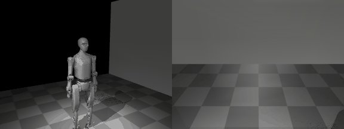
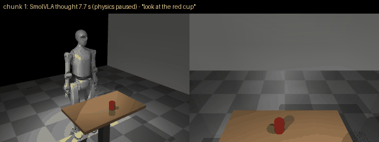

# Humanoid Perception for Edge

A vision-language-action layer for a humanoid, built to run on a CPU: a camera and a
sentence in, a smooth stream of upper-body joint targets out. First on a standing robot in
MuJoCo, then on a real camera, then on a robot, and last on a Jetson.

The reference robot is the **Tiangong 2 Pro** (published as Tiangong 2.0 Pro in the Open
X-Humanoid URDF release; OpenAtom Open Hardware License 1.0, vendored with provenance under
`assets/robots/`). Any
other robot with the same upper-body joint names plugs in through a `BodyConfig` — the
action contract resolves joints by name — without changing the code or the repository.

The design, the decisions and the milestones are in [`docs/PLAN.md`](docs/PLAN.md). Read
it first.

## Quick start

```powershell
$env:PYTHONIOENCODING = "utf-8"
uv sync                              # Python 3.12 environment from uv.lock

uv run scripts\stand.py              # the robot holds HOME for 60 s; its head camera renders the room
uv run scripts\stand.py --view       # the same, with the MuJoCo viewer open
uv run pytest                        # the M0 gate as tests
```

## Layout

| Path | What |
|---|---|
| `humanoid_perception/robot/contract.py` | **The one contract**: the 17-joint upper-body action stream, resolved by joint name |
| `humanoid_perception/robot/loader.py` | URDF → MuJoCo, done right (mimics, unfused links, hidden collision meshes, motors); `BodyConfig.from_yaml` for other bodies |
| `humanoid_perception/robot/camera.py` | The RGB-D camera: intrinsics, pose, metric depth |
| `humanoid_perception/sim/stand.py` | The standing robot: legs locked, pelvis bolted just above the floor, 50 Hz control clock; optional table with a red cup |
| `humanoid_perception/vla/` | VLAs driving the robot: `smolvla.py` (loader + driver), `safety.py` (envelope, joint limits, rate limit on every command) |
| `humanoid_perception/bench/` | The CPU latency census: machine state, power watch, timing, results |
| `assets/robots/tiangong2pro/` | The Tiangong 2 Pro, the reference robot, vendored with `PROVENANCE.md`, `LICENCE` and a hash manifest |
| `scripts/` | `stand.py`, `make_gif.py`, `census.py`, `vla_loop.py` |
| `tests/` | Every claim above, as a test |
| `docs/` | `PLAN.md`, `BENCHMARKS.md` |

A gitignored `private/` folder can hold bodies and notes that are not public; nothing in
it is ever committed.

## Status

| milestone | state |
|---|---|
| M0 bootstrap | robot loads, holds HOME, renders from the head camera; tests green |
| M1 CPU latency census | first row: SmolVLA-base, 9.62 s per 50-action chunk on an i5-10210U ([BENCHMARKS.md](docs/BENCHMARKS.md)); SmolVLA in the loop on the robot (plumbing test, below) |

### M0 — the standing robot



Left: an outside view. Right: what the robot's head camera sees at the same moment, the
image every model in this project will consume. The motion is a scripted sequence through
the 17-joint action stream (`scripts/make_gif.py`); the camera moves with the head.

### M1 — SmolVLA in the loop (plumbing test)



`uv run scripts/vla_loop.py`: the head camera's frame and the instruction "look at the red
cup" go to `lerobot/smolvla_base` (fp32 on the CPU); physics pauses while it thinks (7.7 to
9.4 s per chunk on the i5); the robot then executes the 50-step chunk at 50 Hz through the
safety filter. The base checkpoint was trained on 6-joint arms, so here its five arm outputs
drive five right-arm joints by small, clamped offsets and **the motion means nothing yet**.
What the test proves is the loop: frames in, chunks out, safe execution (every command held
within ±0.30 rad and rate-limited, even when the model's outputs drifted far out of range),
and the real cost on this CPU. Fine-tuning on demonstrations of this robot comes next.
